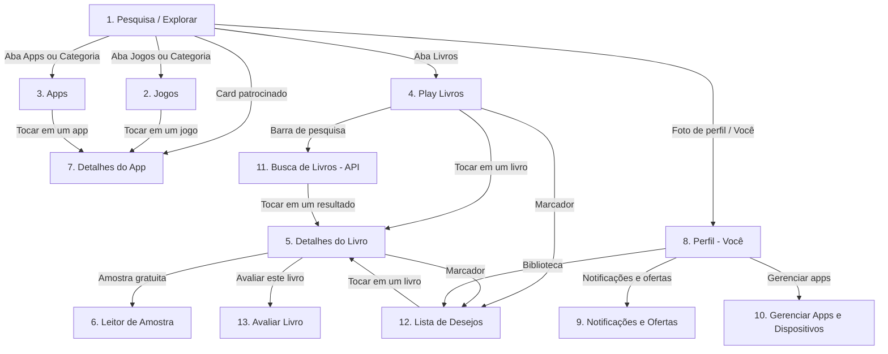

# 📱 Google Play Store Mock • Aplicativo Mobile Híbrido

Projeto prático desenvolvido para a disciplina de **Aplicativos Híbridos** do curso de **Engenharia de Software** — **Universidade de Vassouras**.

O aplicativo reproduz a interface da **Google Play Store** (com abas de **Jogos**, **Apps**, **Pesquisa**, **Play Livros** e **Perfil**) seguindo o **Material Design 3 em tema escuro**. Foi construído com **React Native + Expo**, navegação baseada em arquivos com **Expo Router**, **consumo de API** real com cache offline, **armazenamento local** no dispositivo e separação em camadas seguindo princípios **SOLID**.

---

## 🎯 Objetivo do Projeto

Tornar funcional um aplicativo completo no ecossistema Expo, aplicando os conteúdos das aulas da disciplina:

| Requisito | Como foi aplicado |
| :--- | :--- |
| **StyleSheet + Flexbox & Tema** | Todas as telas usam `StyleSheet.create` com `flexDirection`, `gap`, `flex: 1` e layout responsivo (`useWindowDimensions`), apoiados pelo tema centralizado em `src/theme.ts` (`colors`, `spacing`, `radius` e `readerThemes`). |
| **Navegação com Expo Router** | **13 telas** em `src/app/`, pilha configurada em `_layout.tsx`, passagem de parâmetros entre rotas (`useLocalSearchParams`) e atualização ao voltar para a tela (`useFocusEffect`). |
| **Consumo de API** | Busca de livros, gêneros, capas e sinopses na **[Open Library API](https://openlibrary.org/developers/api)**, tratando os **4 estados de tela** (`carregando`, `erro`, `vazio`, `sucesso`), cancelamento (`AbortController`) e **Pull-to-Refresh** (`refreshing`/`onRefresh`). |
| **Armazenamento local & Cache** | Wrapper tipado (`storage.ts`) e cache com validade TTL + fallback offline (`cache.ts`) sobre **AsyncStorage**, persistindo lista de desejos, avaliações, histórico de buscas, apps instalados, preferências do leitor e notificações lidas. |

---

## 🗺️ As 13 Telas do Aplicativo



| # | Tela | Arquivo | Descrição |
| :-: | :--- | :--- | :--- |
| **1** | **Pesquisa & Explorar** | `src/app/index.tsx` | Tela inicial com barra de busca, grid de categorias de jogos e apps, cards patrocinados (Booking.com e Shopee com parâmetros dinâmicos) e rodapé fixo. |
| **2** | **Jogos** | `src/app/jogos.tsx` | Aba **Jogos** com busca interna, chips de filtro por gênero (`Ação`, `RPG`, `Estratégia`, `Corrida`, `Simulador`, `Quebra-cabeças`), destaque editorial e lista navegável. |
| **3** | **Apps** | `src/app/apps.tsx` | Aba **Apps** com busca interna, chips de categoria (`Produtividade`, `Ferramentas`, `Viagens`, `Compras`), carrossel horizontal de recomendados e lista de aplicativos essenciais. |
| **4** | **Play Livros** | `src/app/livros.tsx` | Vitrine com carrosséis de e-books clicáveis, atalho para busca e lista de desejos, e abas funcionais (`E-books`, `Audiolivros`, `Gêneros` via API com cache, `Os mais vendidos`). |
| **5** | **Detalhes do Livro** | `src/app/livro-detalhes.tsx` | Capa, autor, nota, páginas, sinopse (da Open Library API ou da vitrine), compra simulada, lista de desejos, atalho para amostra gratuita e avaliação do usuário. |
| **6** | **Leitor de Amostra** | `src/app/leitor-amostra.tsx` | Leitor de prévia gratuita de e-books com controle de tamanho de fonte (`A-`/`A+`), temas (`Escuro`, `Sépia`, `Claro`), paginação e progresso persistidos no AsyncStorage. |
| **7** | **Detalhes do App** | `src/app/booking-detalhes.tsx` | Página dinâmica de instalação (Booking.com, Shopee, jogos e apps das abas) com simulação de download e estado instalado persistido no AsyncStorage. |
| **8** | **Perfil (Você)** | `src/app/perfil.tsx` | Painel da conta Google com atalhos para Gerenciar apps, Notificações (badge dinâmico de não lidas) e Biblioteca, com transição lateral suave. |
| **9** | **Notificações e Ofertas** | `src/app/notificacoes.tsx` | Central de ofertas e alertas com filtro (`Todas` / `Não lidas`), marcação individual ou em lote persistida no AsyncStorage e redirecionamento para promoções. |
| **10** | **Gerenciar Apps e Dispositivos** | `src/app/gerenciar.tsx` | Abas **Visão geral** e **Gerenciar**, listando aplicativos instalados do AsyncStorage (com desinstalação direta) e o resumo das avaliações de livros salvas. |
| **11** | **Busca de Livros** | `src/app/busca-livros.tsx` | Pesquisa em tempo real na **Open Library API** (debounce de 500 ms + `AbortController`), Pull-to-Refresh, sugestões rápidas e histórico recente salvo no AsyncStorage. |
| **12** | **Lista de Desejos** | `src/app/biblioteca.tsx` | Livros salvos com **AsyncStorage**, data de salvamento, exclusão individual e atualização automática ao voltar para a tela (`useFocusEffect`). |
| **13** | **Avaliar Livro** | `src/app/avaliar-livro.tsx` | Avaliação de 1 a 5 estrelas com resenha opcional (até 500 caracteres), salva com **AsyncStorage**; permite editar e excluir. |

---

## 🛠️ Tecnologias e Dependências

- **Framework:** [Expo](https://expo.dev/) (SDK 57)
- **Biblioteca base:** [React Native](https://reactnative.dev/) 0.86 e [React](https://react.dev/) 19
- **Roteamento:** [Expo Router](https://docs.expo.dev/router/introduction/) (navegação baseada em arquivos com `typedRoutes`)
- **Linguagem:** [TypeScript](https://www.typescriptlang.org/) (modo estrito)
- **API externa:** [Open Library](https://openlibrary.org/developers/api) (busca por texto, busca por assunto/gênero, detalhes e capas)
- **Armazenamento local:** [`@react-native-async-storage/async-storage`](https://react-native-async-storage.github.io/async-storage/)
- **Ícones:** [@expo/vector-icons](https://icons.expo.fyi/) (Ionicons e MaterialCommunityIcons)
- **Áreas seguras:** `react-native-safe-area-context`
- **Estilização:** `StyleSheet` nativo com tokens centralizados em `src/theme.ts`

---

## 🏛️ Arquitetura (Camadas & Princípios SOLID)

O código segue separação clara entre **Apresentação (UI)**, **Estado** e **Camada de Dados**, aplicando **SRP**, **OCP**, **LSP**, **ISP** e **DIP**:

- **Design System (`src/theme.ts`):** concentra `colors`, `spacing`, `radius` e `readerThemes` em um único ponto.
- **Apresentação (UI - `src/app/`):** 13 telas focadas em renderização e interação.
- **Estado:** `useState`, `useEffect`, `useMemo` e `useFocusEffect` controlam carregamento, erro, vazio, sucesso e hidratação local.
- **Dados (`src/services/`):** serviços desacoplados para API HTTP, cache offline e persistência local com injeção de driver de armazenamento (`StorageDriver` / `TypedStorage`).

| Módulo | Responsabilidade (SRP) |
| :--- | :--- |
| `src/theme.ts` | Tokens visuais centralizados do Material 3 Dark e paletas do leitor (`Escuro`, `Sépia`, `Claro`). |
| `src/services/storage.ts` | Wrapper tipado (`createStorage`, `storage.get<T>`, `set<T>`, `remove`) com abstração `StorageDriver` (DIP). |
| `src/services/cache.ts` | Estratégia genérica `comCache<T>` com validade TTL e fallback automático offline. |
| `src/services/openLibrary.ts` | `searchBooks()`, `searchBooksBySubject()` (com cache TTL) e `getBookDetails()` na Open Library API. |
| `src/services/searchHistory.ts` | Histórico recente de pesquisas no AsyncStorage (máximo de 8 termos, sem duplicatas). |
| `src/services/installedApps.ts` | Instalação, listagem, verificação e desinstalação persistente de apps e jogos. |
| `src/services/wishlist.ts` | Adicionar, remover, verificar e listar livros na lista de desejos no AsyncStorage. |
| `src/services/reviews.ts` | Salvar, ler, listar ordenadamente (`getAllReviewsList`) e excluir avaliações no AsyncStorage. |

---

## 🚀 Como Executar o Projeto

### Pré-requisitos
- **Node.js** (versão LTS: 20 ou 22)
- **npm**
- Aplicativo **Expo Go** no celular (opcional, para testar em um aparelho físico)

### 1. Clonar o repositório e instalar as dependências
```powershell
git clone https://github.com/pfFabio/trabHibrido.git
cd trabHibrido
npm install
```

### 2. Rodar no navegador (Web)
```powershell
npm run web
```
> O app abre em `http://localhost:8081`. Pressione `F12` e ative a visão de celular (modo responsivo) para simular o aparelho.

### 3. Rodar no celular (Expo Go)
```powershell
npx expo start
```
> Abra o **Expo Go** no Android ou iOS e leia o QR Code exibido no terminal.

> ℹ️ A busca de livros por texto usa conexão com a internet; a navegação por gêneros em Play Livros conta com cache local TTL para funcionar mesmo após perder conexão. Lista de desejos, avaliações, histórico, notificações, leitor e apps instalados funcionam offline via AsyncStorage.

---

## 📂 Estrutura de Pastas

```text
trabHibrido/
├── assets/                     # Imagens, ícones e fontes locais
├── src/
│   ├── theme.ts                # Tokens centralizados de cores, espaçamentos e leitor
│   ├── app/                    # 13 telas e rotas (Expo Router)
│   │   ├── _layout.tsx         # Pilha de navegação e animações de transição
│   │   ├── index.tsx           # 1. Pesquisa & Explorar (tela inicial)
│   │   ├── jogos.tsx           # 2. Aba Jogos
│   │   ├── apps.tsx            # 3. Aba Apps
│   │   ├── livros.tsx          # 4. Play Livros (vitrine + gêneros via API)
│   │   ├── livro-detalhes.tsx  # 5. Detalhes do livro
│   │   ├── leitor-amostra.tsx  # 6. Leitor de amostra gratuita (AsyncStorage)
│   │   ├── booking-detalhes.tsx# 7. Detalhes dinâmicos de app/jogo (AsyncStorage)
│   │   ├── perfil.tsx          # 8. Perfil (Você)
│   │   ├── notificacoes.tsx    # 9. Notificações e ofertas (AsyncStorage)
│   │   ├── gerenciar.tsx       # 10. Gerenciar apps e dispositivos
│   │   ├── busca-livros.tsx    # 11. Busca de livros (Open Library API + Histórico)
│   │   ├── biblioteca.tsx      # 12. Lista de desejos (AsyncStorage)
│   │   └── avaliar-livro.tsx   # 13. Avaliar livro (AsyncStorage)
│   └── services/               # Camada de dados
│       ├── storage.ts          # Wrapper tipado do AsyncStorage (DIP)
│       ├── cache.ts            # Cache genérico com TTL e fallback offline
│       ├── openLibrary.ts      # Consumo da Open Library API
│       ├── searchHistory.ts    # Histórico de buscas no AsyncStorage
│       ├── installedApps.ts    # Apps instalados no AsyncStorage
│       ├── wishlist.ts         # Lista de desejos no AsyncStorage
│       └── reviews.ts          # Avaliações no AsyncStorage
├── app.json                    # Configuração do Expo
├── package.json                # Dependências e scripts
├── tsconfig.json               # Configuração do TypeScript
└── README.md                   # Documentação do projeto
```

---

## 👥 Integrantes do Grupo

*Engenharia de Software — Universidade de Vassouras*
- **Aluno 1:** Fábio Pinto Figueiredo — Matrícula: 202413741
- **Aluno 2:** Daniel Augusto — Matrícula: 202322047
