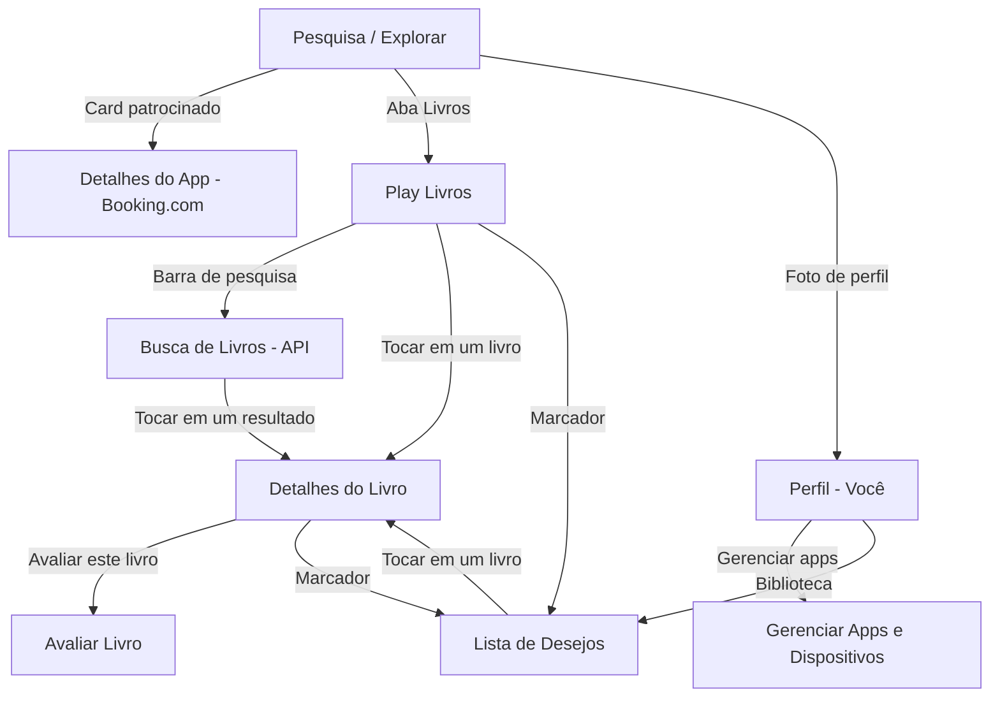

# 📱 Google Play Store Mock • Aplicativo Mobile Híbrido

Projeto prático desenvolvido para a disciplina de **Aplicativos Híbridos** do curso de **Engenharia de Software** — **Universidade de Vassouras**.

O aplicativo reproduz a interface da **Google Play Store** (com foco na **Play Livros**) seguindo o **Material Design 3 em tema escuro**. Ele foi construído com **React Native + Expo**, navegação por arquivos com **Expo Router**, **consumo de API** real e **armazenamento local** no dispositivo.

---

## 🎯 Objetivo do Projeto

Tornar funcional um aplicativo existente, exercitando os conceitos da disciplina:

| Requisito | Como foi aplicado |
| :--- | :--- |
| **StyleSheet + Flexbox** | Todas as telas usam `StyleSheet.create` com layouts em `flexDirection`, `gap` e `flex`, adaptando-se a celular e PC (`useWindowDimensions`). |
| **Navegação com Expo Router** | Rotas baseadas em arquivos em `src/app/`, pilha configurada em `_layout.tsx`, passagem de parâmetros entre telas (`useLocalSearchParams`) e recarga de dados ao voltar (`useFocusEffect`). |
| **Consumo de API** | Busca de livros, capas e sinopses na **[Open Library API](https://openlibrary.org/developers/api)** (pública e sem chave), com estados de carregando, erro e "sem resultados". |
| **Armazenamento local** | **AsyncStorage** guarda a lista de desejos e as avaliações do usuário, que continuam salvas depois de fechar o app. |

---

## 🗺️ Telas do Aplicativo



| # | Tela | Arquivo | Descrição |
| :-: | :--- | :--- | :--- |
| **1** | **Pesquisa & Explorar** | `src/app/index.tsx` | Tela inicial com barra de busca, grid de categorias de jogos, cards patrocinados (Booking.com e Shopee) e barra de navegação inferior fixa. |
| **2** | **Play Livros** | `src/app/livros.tsx` | Vitrine com carrosséis de e-books (menos de R$ 5, mais vendidos, adaptações), abas de filtro e atalhos para a busca e a lista de desejos. |
| **3** | **Detalhes do Livro** | `src/app/livro-detalhes.tsx` | Capa, autor, nota, páginas, sinopse carregada da API, compra simulada, botão de lista de desejos e seção com a avaliação do usuário. Layout próprio para PC e celular. |
| **4** | **Detalhes do App (Booking.com)** | `src/app/booking-detalhes.tsx` | Página de instalação de um app, com capturas de tela, informações e avaliações. |
| **5** | **Perfil (Você)** | `src/app/perfil.tsx` | Painel da conta Google com menu de opções (Gerenciar apps, Notificações, Biblioteca, Play Points...) e animação de entrada lateral. |
| **6** | **Gerenciar Apps e Dispositivos** | `src/app/gerenciar.tsx` | Visão geral da conta: Play Protect, atualizações pendentes, armazenamento em uso, sincronização de dispositivos e notas e avaliações. |
| **7** | **Busca de Livros** | `src/app/busca-livros.tsx` | Pesquisa em tempo real na **Open Library API** (com atraso de 500 ms e cancelamento da busca anterior), lista com capa, autor, nota e ano, e estados de carregando, erro e sem resultados. |
| **8** | **Lista de Desejos** | `src/app/biblioteca.tsx` | Livros salvos com **AsyncStorage**, com data de salvamento, remoção e atualização automática ao voltar para a tela. |
| **9** | **Avaliar Livro** | `src/app/avaliar-livro.tsx` | Avaliação de 1 a 5 estrelas com resenha opcional (até 500 caracteres), salva com **AsyncStorage**; permite editar e excluir. |

---

## 🛠️ Tecnologias e Dependências

- **Framework:** [Expo](https://expo.dev/) (SDK 57)
- **Biblioteca base:** [React Native](https://reactnative.dev/) 0.86 e [React](https://react.dev/) 19
- **Roteamento:** [Expo Router](https://docs.expo.dev/router/introduction/) (navegação baseada em arquivos)
- **Linguagem:** [TypeScript](https://www.typescriptlang.org/) (modo estrito)
- **API externa:** [Open Library](https://openlibrary.org/developers/api) (busca, detalhes e capas de livros)
- **Armazenamento local:** [`@react-native-async-storage/async-storage`](https://react-native-async-storage.github.io/async-storage/)
- **Ícones:** [@expo/vector-icons](https://icons.expo.fyi/) (Ionicons e MaterialCommunityIcons)
- **Áreas seguras:** `react-native-safe-area-context`
- **Estilização:** `StyleSheet` nativo com a paleta Material 3 Dark (`#131314`, `#1E1F22`, `#282A2C`, `#004A77`, `#A8C7FA`, `#C2E7FF`)

---

## 🏛️ Arquitetura

O código é separado em camadas:

- **Apresentação (UI):** telas em `src/app/`, cada uma com seus componentes e estilos.
- **Estado:** `useState`, `useEffect` e `useFocusEffect` controlam os dados de cada tela (carregando, erro, sucesso).
- **Dados:** serviços em `src/services/` isolam o acesso à API e ao armazenamento local, e são reaproveitados por várias telas.

| Serviço | Responsabilidade |
| :--- | :--- |
| `openLibrary.ts` | `searchBooks()` e `getBookDetails()`: chamadas à Open Library API e conversão dos dados para o formato do app. |
| `wishlist.ts` | Adicionar, remover e listar livros da lista de desejos no AsyncStorage. |
| `reviews.ts` | Salvar, ler e excluir a avaliação do usuário para cada livro no AsyncStorage. |

---

## 🚀 Como Executar o Projeto

### Pré-requisitos
- **Node.js** (versão LTS: 20 ou 22)
- **npm**
- Aplicativo **Expo Go** no celular (opcional, para testar em um aparelho físico)

### 1. Clonar o repositório e instalar as dependências
```powershell
git clone https://github.com/pfFabio/trabHibrido.git
cd trabHibrido
npm install
```

### 2. Rodar no navegador (Web)
```powershell
npm run web
```
> O app abre em `http://localhost:8081`. Pressione `F12` e ative a visão de celular (modo responsivo) para simular o aparelho.

### 3. Rodar no celular (Expo Go)
```powershell
npx expo start
```
> Abra o **Expo Go** no Android ou iOS e leia o QR Code exibido no terminal.

> ℹ️ A busca de livros precisa de conexão com a internet. A lista de desejos e as avaliações funcionam offline, pois ficam salvas no próprio dispositivo.

---

## 📂 Estrutura de Pastas

```text
trabHibrido/
├── assets/                     # Imagens, ícones e fontes locais
├── src/
│   ├── app/                    # Telas e rotas (Expo Router)
│   │   ├── _layout.tsx         # Pilha de navegação e animações de transição
│   │   ├── index.tsx           # Pesquisa & Explorar (tela inicial)
│   │   ├── livros.tsx          # Play Livros
│   │   ├── livro-detalhes.tsx  # Detalhes do livro
│   │   ├── booking-detalhes.tsx# Detalhes do app Booking.com
│   │   ├── perfil.tsx          # Perfil (Você)
│   │   ├── gerenciar.tsx       # Gerenciar apps e dispositivos
│   │   ├── busca-livros.tsx    # Busca de livros (Open Library API)
│   │   ├── biblioteca.tsx      # Lista de desejos (AsyncStorage)
│   │   └── avaliar-livro.tsx   # Avaliar livro (AsyncStorage)
│   └── services/               # Camada de dados
│       ├── openLibrary.ts      # Consumo da Open Library API
│       ├── wishlist.ts         # Lista de desejos no AsyncStorage
│       └── reviews.ts          # Avaliações no AsyncStorage
├── app.json                    # Configuração do Expo
├── package.json                # Dependências e scripts
├── tsconfig.json               # Configuração do TypeScript
└── README.md                   # Documentação do projeto
```

---

## 👥 Integrantes do Grupo

*Engenharia de Software — Universidade de Vassouras*
- **Aluno 1:** Fábio Pinto Figueiredo — Matrícula: 202413741
- **Aluno 2:** Daniel Augusto — Matrícula: 202322047
